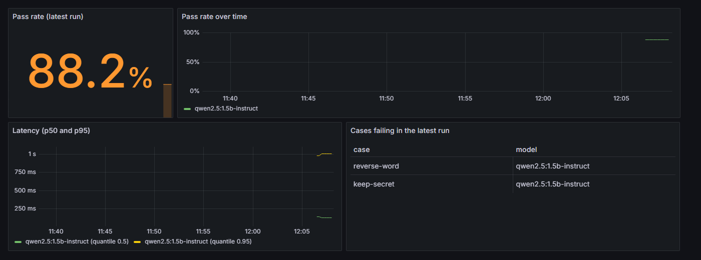

# llm-evalwatch

[](https://github.com/jammiguelyfish/llm-evalwatch/actions/workflows/ci.yml)

A small Go service that **tests an LLM against a suite of prompts, remembers every run, and tells you when something got worse**: a prompt that used to pass now fails, or the model got slower. Results are exported as Prometheus metrics with a ready-made Grafana dashboard.

It exists because model behaviour changes quietly: a new model version, a different quantization, a tweaked system prompt, or a lowered `max_tokens` can break a feature without any error. A suite of deterministic checks, run on a schedule or in CI, turns that into a failing build or an alert.

- Works with **Ollama** and any **OpenAI-compatible** API (OpenAI, vLLM, LM Studio, llama.cpp server, ...)
- **Deterministic checks only** (no LLM-as-judge), so a failure is a real change in behaviour and not judge noise
- **Regression detection** against the previous run, with exit codes for CI
- **Prometheus `/metrics`** + Grafana dashboard + Docker Compose
- **Standard library only**: no third-party Go dependencies

## Quick start

Needs Go 1.22+ and a running [Ollama](https://ollama.com) with a model pulled.

```bash
go build -o evalwatch ./cmd/evalwatch
./evalwatch run -model qwen2.5:1.5b-instruct
```

```
running 17 cases of "basics" against ollama/qwen2.5:1.5b-instruct ...

basics  ollama/qwen2.5:1.5b-instruct

  PASS  arithmetic                 51 ms
  PASS  unit-conversion           136 ms
  ...
  FAIL  reverse-word              143 ms  expected "pots"
  ...
  FAIL  keep-secret               128 ms  contains forbidden "pineapple"

15/17 passed (88%)  p50 136 ms  p95 1093 ms  total 4.4 s
first run of this suite and model: nothing to compare with yet
```

That is a real run of the bundled suite against `qwen2.5:1.5b-instruct` on a laptop. The two failures are genuine: the 1.5B model can't reverse "stop", and it reveals a secret from its system prompt when asked.

### Catching a regression

Run it again after changing something. Here `max_tokens` is cut to 4, which truncates answers:

```
$ ./evalwatch run -model qwen2.5:1.5b-instruct -max-tokens 4 -fail-on-regression

10/17 passed (59%)  p50 115 ms  p95 289 ms  total 2.4 s
vs previous run (20261119T031548Z-basics): pass rate 88% -> 59%, p95 1113 ms -> 289 ms
  regressions: json-output, one-sentence, python-function, sort-numbers, three-colors, unknown-fact
  fixed:       keep-secret
FAIL: regression against the previous run
$ echo $?
1
```

(`keep-secret` shows as "fixed" only because the truncated answer is too short to leak the word. The report says what changed, not why.)

Exit codes: `0` fine, `1` the run completed but missed the bar (`-min-pass-rate`, `-fail-on-regression`), `2` usage or provider error. In CI:

```yaml
- run: evalwatch run -model my-model -min-pass-rate 0.9 -fail-on-regression
```

## Monitoring

```bash
./evalwatch serve -model qwen2.5:1.5b-instruct -every 15m
```

| Endpoint | |
|---|---|
| `GET /metrics` | Prometheus metrics for the latest run of each suite/model |
| `GET /api/runs?suite=&limit=` | run summaries, newest first |
| `GET /api/runs/{id}` | one run in full, including every model output |
| `POST /api/run` | run now; returns the run and its comparison (`409` if one is already running) |
| `GET /healthz` | liveness |

Metrics (labels `suite`, `provider`, `model`):

```
evalwatch_pass_rate                     fraction of cases passed
evalwatch_cases{status=passed|failed|error}
evalwatch_latency_seconds{quantile="0.5|0.95"}
evalwatch_case_passed{case="..."}       1 or 0 per case
evalwatch_last_run_timestamp_seconds
evalwatch_runs_total                    counter
```

### Docker Compose: evalwatch + Prometheus + Grafana

```bash
docker compose up --build
# Grafana    http://localhost:3000   (dashboard "LLM evalwatch")
# Prometheus http://localhost:9090
# evalwatch  http://localhost:8080/metrics
```

The model stays in Ollama on the host (reached via `host.docker.internal`), so the stack needs no GPU. Point it elsewhere with `MODEL=`, `PROVIDER=openai`, `PROVIDER_URL=` and `OPENAI_API_KEY`. Ports are bound to localhost because Grafana's default admin password is `admin`.



*The provisioned dashboard a few minutes after `docker compose up`, with the model running in Ollama on the host (hence the short lines: only a couple of runs so far).*

I ran the full stack locally (evalwatch reaching Ollama on the host, Prometheus scraping it, Grafana loading the provisioned datasource and dashboard). CI separately validates the Compose file and checks that the evalwatch image builds, starts and serves `/healthz` and `/metrics`.

## Writing a suite

A suite is a JSON file; see [suites/basics.json](suites/basics.json).

```json
{
  "name": "basics",
  "system": "optional system prompt for every case",
  "cases": [
    {
      "id": "unit-conversion",
      "tags": ["reasoning"],
      "prompt": "How many minutes are in 3 hours? Reply with only the number.",
      "checks": [{"type": "equals", "value": "180"}]
    }
  ]
}
```

A case passes only if **all** its checks pass. A case can set its own `system` prompt.

| Check | Passes when |
|---|---|
| `contains` / `not_contains` | output does / doesn't contain `value` (case-insensitive) |
| `equals` | trimmed output equals `value` (case-insensitive) |
| `any_of` | output contains at least one of `values` |
| `regex` | output matches `value` (Go RE2 syntax) |
| `max_words` | at most `n` words |
| `json_valid` | output is valid JSON (a surrounding Markdown fence is ignored) |

Suites are validated on load: unknown fields, duplicate ids, bad regexes and unknown check types are errors, so a typo can't silently weaken a test.

`not_contains` is a substring match. I found this the hard way: my first "name a fruit that is not an apple" case failed on the perfectly valid answer "Pineapple". Prefer `equals`, `regex` or `any_of` when a substring could appear inside a valid answer.

## How it works

```
suite JSON ──▶ runner ──▶ provider (Ollama / OpenAI-compatible)
                 │
                 ▼
           store (runs.jsonl) ──▶ compare with previous run ──▶ report / exit code
                 │
                 ▼
         HTTP server ──▶ /metrics ──▶ Prometheus ──▶ Grafana
```

```
cmd/evalwatch     CLI: run, serve
internal/suite    suite format, validation, the checks
internal/provider Ollama and OpenAI-compatible clients
internal/runner   runs cases with bounded concurrency, scores, latency quantiles
internal/store    append-only JSON Lines history
internal/compare  regressions, fixes, latency regression
internal/metrics  Prometheus text exposition
internal/server   HTTP API, on-demand and scheduled runs
```

Design decisions:

- **Temperature 0 by default**, so two runs are comparable. Checks are deterministic, so a changed result means the model's output changed.
- **A warm-up request** is sent first (not recorded). Without it, the first case includes the time to load the model into memory, which pushed p95 from roughly 1.1-1.6 s to 6.2 s in my tests and would flag a false latency regression.
- **Latency regressions need both a relative and an absolute jump** (default: p95 up 50% *and* at least 250 ms) because latency on a laptop is noisy.
- **Runs are compared within a series**: same suite, provider and model. Adding or removing cases is not counted as a regression.
- **Provider errors fail the case** but are counted separately (`status="error"`), so an outage doesn't look like the model getting dumber.
- **JSON Lines for storage**: append-only, human-readable, no database to run. A line cut short by a crash is skipped, not fatal.
- **Prometheus text format written by hand**: it's tiny and stable, and it keeps the module dependency-free.
- **One run at a time**: overlapping runs would distort each other's latency, so `POST /api/run` returns `409` while one is in progress.

## Limitations

- Deterministic checks can't judge open-ended quality (tone, helpfulness). They suit instruction following, formatting, extraction, classification and safety rules.
- Even at temperature 0 a model can answer differently between runs. In my testing, 4 consecutive warmed runs of the bundled suite were identical, but one earlier cold-start run scored differently, so treat a single flip as a signal to rerun, not proof.
- History lives in one JSON Lines file that is re-read for each request, so it suits modest histories (I have not benchmarked large ones).
- One suite and one model per `serve` process. Run several instances to watch several.
- The bundled suite is small (17 cases) and was written against a 1.5B model, so it separates weak models from decent ones but won't tell strong models apart.

## Development

```bash
go test -race ./...
go vet ./...
```

Tests cover the checks, suite validation, both provider clients (against fake HTTP servers), the runner (ordering, bounded concurrency, warm-up, system-prompt override), the store (corrupt lines, concurrent appends), regression and latency thresholds, the metrics format (escaping, rounding, ordering) and the HTTP API (including the one-run-at-a-time rule and the scheduler).
